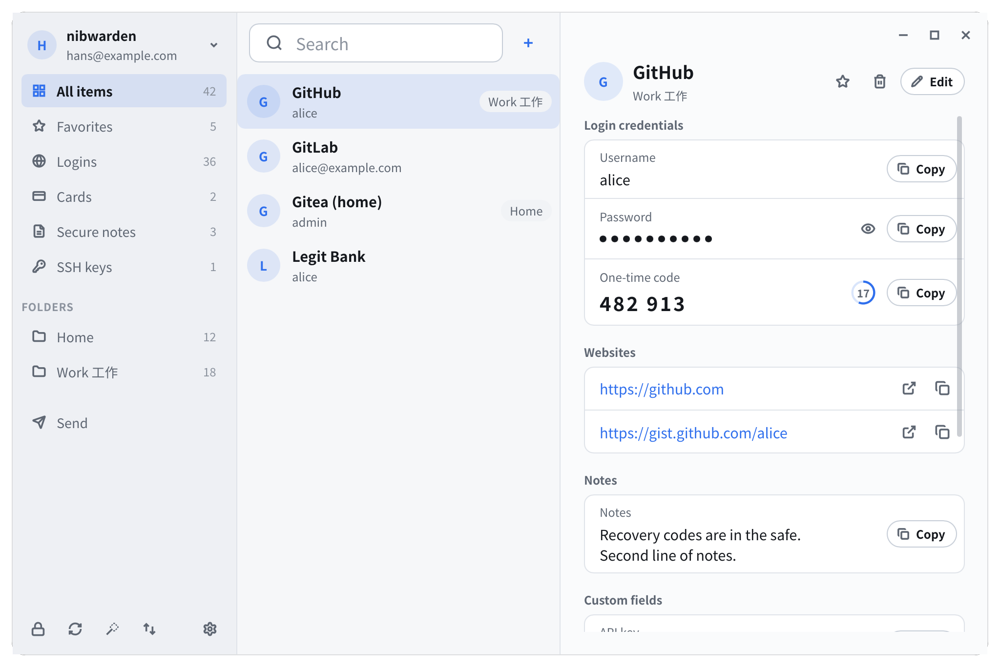
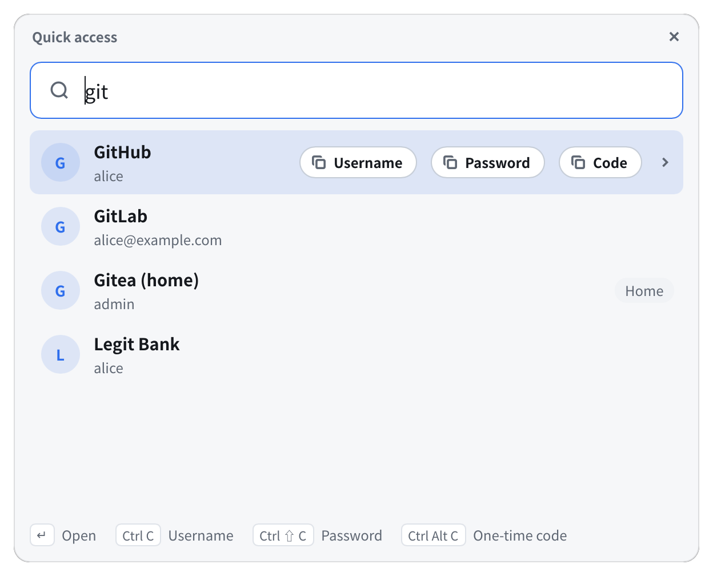
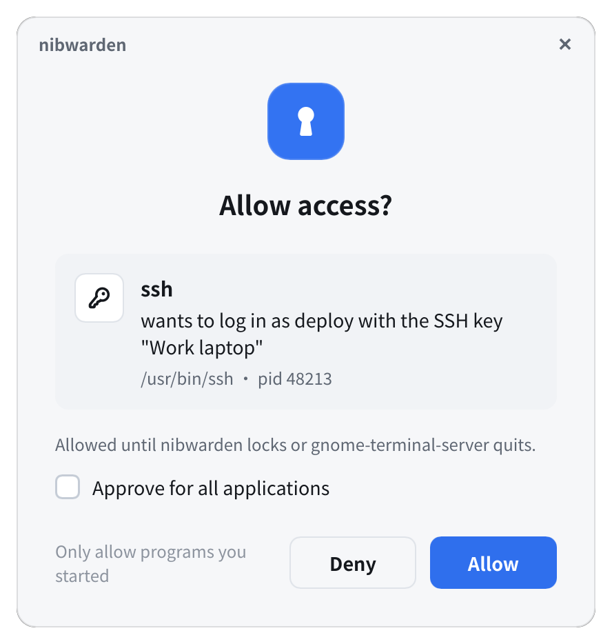

# nibwarden

A Bitwarden-compatible password manager for the Linux desktop, in Rust.

nibwarden keeps your Bitwarden (or Vaultwarden) vault unlocked for your desktop session
and lets your programs use it — the command line, scripts, `ssh`, `git` and the official
Bitwarden browser extension — while asking you in a window before anything reads a
secret. It is modelled on 1Password's desktop app.

[正體中文說明](README.zh-TW.md)



> nibwarden is an independent project. It is not affiliated with or endorsed by
> Bitwarden, Inc. It talks to Bitwarden servers through Bitwarden's own
> [SDK](https://github.com/bitwarden/sdk-internal).

## Features

- **Main window**: browse, search and edit the vault (logins, cards, identities, secure
  notes, SSH keys), favourites and trash, a password generator, Bitwarden Send, import and
  export. Sign in or create an account from the window, with two-step login and new
  device verification.
- **Quick access**: a keyboard-driven search window (Ctrl+Shift+Space) that copies a
  username, password or one-time code. Copied secrets are cleared from the clipboard after
  a while.
- **SSH agent** with the vault's SSH keys, and git commit signing with them
  (`nibwarden ssh git-setup`).
- **Secrets for the command line**: `nibwarden get`, `nibwarden read nw://folder/item/field`
  and `nibwarden run -- command` with `nw://` references in the environment.
- **Approvals**: a program that wants a secret or a signature is shown in a window,
  identified by the operating system, not by what it claims. An approval can cover one
  request, the application, or one terminal tab, until the vault locks or for a set time.
- **Locking**: when idle, when the screen locks and before suspend. While locked, requests
  wait for you to unlock in a window instead of failing.
- **Live sync** with the server's notifications, falling back to periodic sync.
- **Browser extension**: the official Bitwarden extension's "Unlock with biometrics" asks
  in nibwarden's window instead of Bitwarden's desktop app.
- **System tray** icon, light and dark themes, English, 正體中文 and 简体中文.

| Quick access | Approval |
|---|---|
|  |  |

## Status

nibwarden is young software (0.1). It runs on Linux (GNOME and other Wayland or X11
desktops); macOS and Windows are not supported yet. It is tested end to end against
Vaultwarden and has been used with bitwarden.com. Keep an export of your vault, and
report problems in the [issue tracker](https://github.com/hans00/nibwarden/issues).

Not supported yet: managing organisations' items, creating passkeys (existing ones are
kept when an item is edited), two-step login other than an authenticator app or email,
and autofill other than through the official browser extension.

## How it works

```
nibwarden (CLI) ─┐
nibwarden-gui ───┤                ┌─ Bitwarden / Vaultwarden server
ssh, git ────────┼─ nibwardend ───┤
browser host ────┘   (daemon)     └─ encrypted vault cache on disk
```

`nibwardend` is a per-user daemon, started on demand by a systemd user unit. It is the
only program that holds the vault's keys, and only in memory; nothing secret is stored on
disk unencrypted. The CLI, the windows, the SSH agent socket and the browser host all talk
to it over a socket only you can open. Windows that ask for your master password or an
approval are started by the daemon itself, so no other program can answer them.

The design is described in detail (in Chinese) in [docs/architecture](docs/architecture).

## Installing

Each [release](https://github.com/hans00/nibwarden/releases) has packages for x86_64
and aarch64:

| Distribution | Install |
|---|---|
| Debian 12+, Ubuntu 22.04+ | `sudo apt install ./nibwarden_<version>_amd64.deb` |
| Fedora | `sudo dnf install ./nibwarden-<version>-1.x86_64.rpm` |
| Arch Linux | the `PKGBUILD` of the release (for the AUR): `makepkg -si` |
| Nix | `nix run github:hans00/nibwarden -- status`; on NixOS add the flake's package to `environment.systemPackages` and `systemd.packages` |
| Other | `sudo tar -C /usr/local --strip-components=1 -xzf nibwarden-<version>-x86_64-linux.tar.gz` |

Check downloads against the release's `SHA256SUMS`.

### From source

You need Rust 1.92 or newer, `pkg-config`, and the fontconfig and freetype development
files (`libfontconfig-dev libfreetype-dev` on Debian and Ubuntu).

```sh
cargo xtask dist        # builds the packages into target/dist
sudo apt install ./target/dist/nibwarden_*.deb          # or the .rpm, or:
sudo tar -C /usr/local --strip-components=1 -xzf target/dist/nibwarden-*-linux.tar.gz
```

`dist` writes the .deb, .rpm, binary and source tarballs, the PKGBUILD and `SHA256SUMS`,
without needing any distribution's packaging tools. For other recipes,
`cargo xtask install --destdir STAGING --prefix /usr` puts the programs, the systemd user
unit, the desktop entry, icons and man pages into a staging directory.

## Getting started

```sh
nibwarden login --email you@example.com    # bitwarden.com; --server bitwarden.eu or a URL
nibwarden list
nibwarden get GitHub -f totp
```

Or open **nibwarden** from your applications menu and sign in there.

- **SSH**: point `SSH_AUTH_SOCK` at `$XDG_RUNTIME_DIR/nibwarden/ssh-agent.sock`, for
  example by copying `/usr/share/doc/nibwarden/examples/60-nibwarden-ssh-agent.conf` to
  `~/.config/environment.d/` and logging in again.
- **git signing**: `nibwarden ssh git-setup --global`.
- **Quick access shortcut**: Settings → Quick access → Set up (GNOME), or bind
  `nibwarden-gui quick` to a key yourself.
- **Browser extension**: Settings → Browser, or `nibwarden browser enable`; then turn on
  "Unlock with biometrics" in the extension's settings.

Settings live in `~/.config/nibwarden/config.toml` and can be changed in the settings
window. See `man nibwarden` for every command and option.

## Security

- The vault's keys exist only in the daemon's memory, which is protected from core dumps
  and from other programs' tracing where the system allows it.
- Your master password is typed either in the terminal or in a window started by the
  daemon; it is never stored.
- Approvals identify programs by what the operating system reports. A program running as
  you that can trace or inject into other programs can still get around them, as with any
  desktop password manager. Prefer a Wayland session: on X11 any program can read the
  keyboard.

Please report security problems privately as described in [SECURITY.md](SECURITY.md).

## Development

The workspace has one crate per component (`crates/`): `nibwarden-core` wraps the
Bitwarden SDK and is the only crate that uses it; `nibwarden-daemon`, `nibwarden-cli`,
`nibwarden-gui` (Slint), `nibwarden-ipc`, `nibwarden-platform` (everything OS-specific),
`nibwarden-ssh-agent` and `nibwarden-config`.

```sh
cargo xtask check                      # formatting, clippy and unit tests
cargo xtask check --target x86_64-pc-windows-gnu   # also compile for another platform
scripts/e2e.sh                         # end to end, against Vaultwarden in docker
cargo run -p nibwarden-gui --example snapshot -- /tmp/shots   # render every window to PNG
```

CI runs the same checks, compiles the workspace on macOS and Windows, and runs the end to
end tests. Pushing a tag `v<version>` builds the packages and drafts a release. See
[CONTRIBUTING.md](CONTRIBUTING.md).

## License

[GPL-3.0-only](LICENSE).
