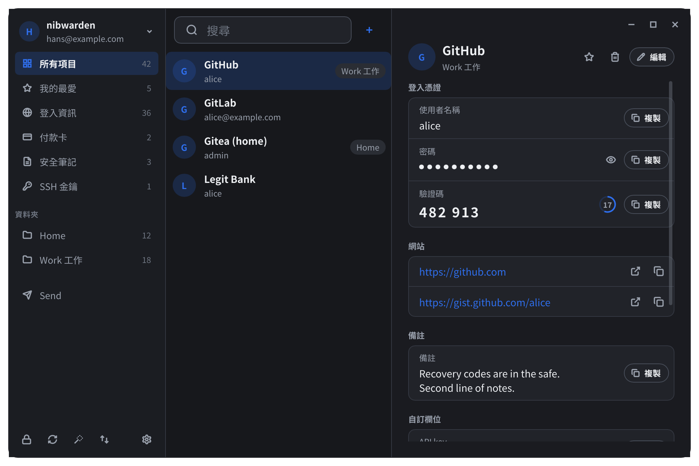
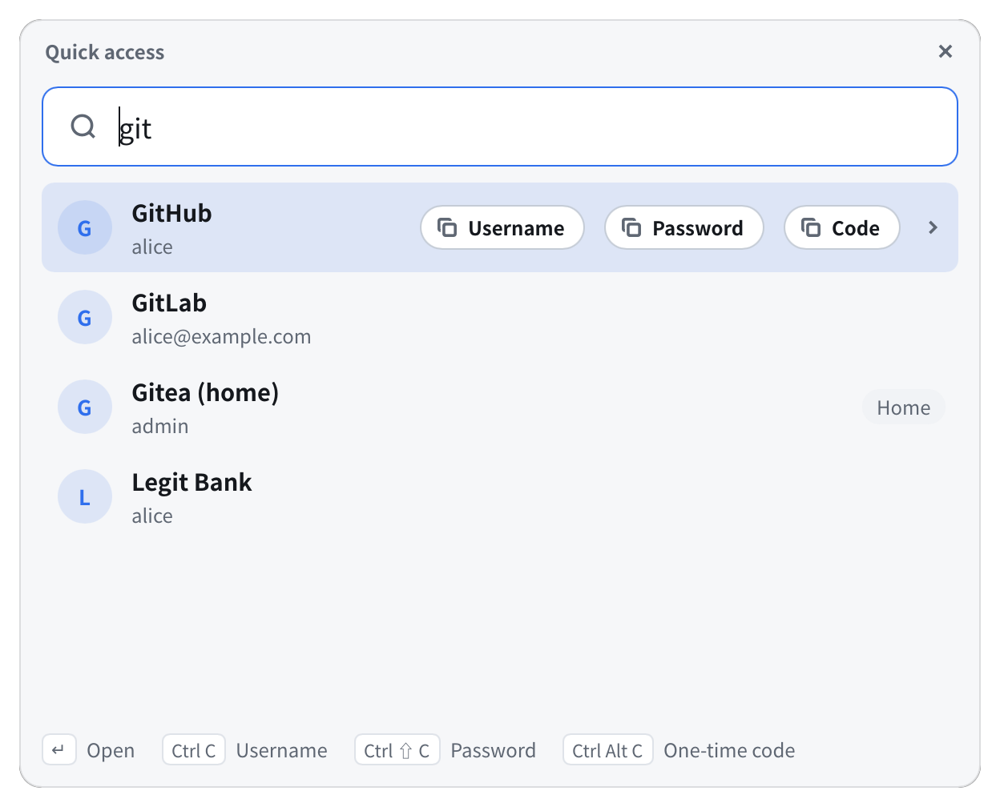
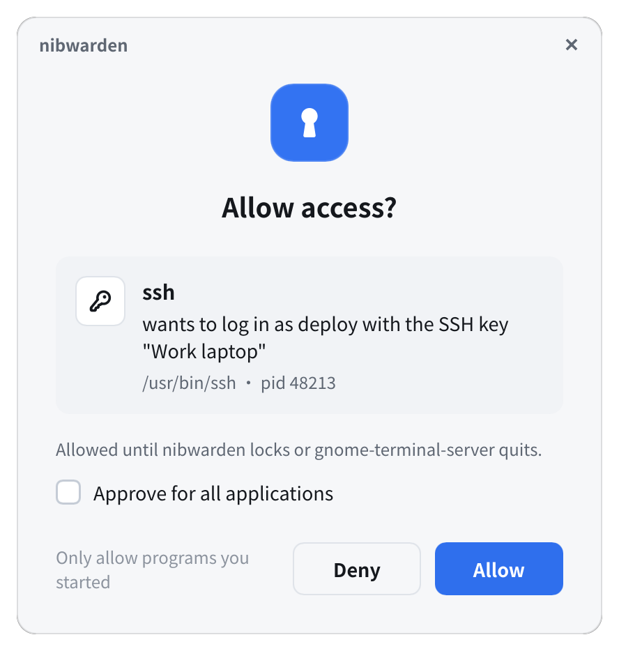

# nibwarden

以 Rust 撰寫、與 Bitwarden 相容的 Linux 桌面密碼管理器。

nibwarden 在你的桌面工作階段裡保持 Bitwarden（或 Vaultwarden）密碼庫解鎖，讓你的程式使用它：命令列、腳本、`ssh`、`git`，以及官方的 Bitwarden 瀏覽器擴充套件。任何程式讀取秘密之前，都會先開視窗問你。設計上參考 1Password 的桌面程式。

[English](README.md)



> nibwarden 是獨立專案，與 Bitwarden, Inc. 沒有關係，也未經其背書。它透過 Bitwarden 自己的 [SDK](https://github.com/bitwarden/sdk-internal) 與 Bitwarden 伺服器溝通。

## 功能

- **主視窗**：瀏覽、搜尋、編輯密碼庫（登入資訊、付款卡、身分、安全筆記、SSH 金鑰），我的最愛與垃圾桶、密碼產生器、Bitwarden Send、匯入與匯出。可以直接在視窗裡登入或建立帳號，支援兩步驟驗證與新裝置驗證。
- **快速存取**：以鍵盤操作的搜尋視窗（Ctrl+Shift+Space），複製使用者名稱、密碼或驗證碼；複製的秘密一段時間後會從剪貼簿清除。
- **SSH agent**：提供密碼庫裡的 SSH 金鑰，也能用它們簽署 git commit（`nibwarden ssh git-setup`）。
- **給命令列的秘密**：`nibwarden get`、`nibwarden read nw://資料夾/項目/欄位`，以及把環境變數中的 `nw://` 參照換成實際值的 `nibwarden run -- 指令`。
- **使用前確認**：程式要讀秘密或簽章時，視窗會顯示是哪個程式（由作業系統認定，不是程式自稱）。核准可以只限這一次、整個應用程式或一個終端機分頁，直到上鎖或一段時間後失效。
- **自動上鎖**：閒置時、螢幕鎖定時、休眠前。上鎖時程式的請求會等你在視窗裡解鎖，而不是直接失敗。
- **即時同步**：接收伺服器的通知，連不上時退回定期同步。
- **瀏覽器擴充套件**：官方 Bitwarden 擴充套件的生物辨識解鎖改由 nibwarden 的視窗確認，不需要 Bitwarden 桌面版。
- **系統匣**圖示、淺色與深色主題、English、正體中文、简体中文。

| 快速存取 | 使用前確認 |
|---|---|
|  |  |

## 狀態

nibwarden 還很年輕（0.1）。目前只支援 Linux（GNOME 與其他 Wayland 或 X11 桌面），macOS 與 Windows 尚未支援。端對端測試以 Vaultwarden 進行，也在 bitwarden.com 上使用過。請保留一份密碼庫的匯出檔，遇到問題請回報到 [issue tracker](https://github.com/hans00/nibwarden/issues)。

尚未支援：管理組織的項目、建立通行金鑰（編輯項目時會保留既有的）、驗證器 App 與電子郵件以外的兩步驟驗證方式、透過官方擴充套件以外的自動填入。

## 運作方式

```
nibwarden（CLI）─┐
nibwarden-gui ───┤                ┌─ Bitwarden／Vaultwarden 伺服器
ssh、git ────────┼─ nibwardend ───┤
瀏覽器 host ─────┘   （daemon）    └─ 磁碟上加密的密碼庫快取
```

`nibwardend` 是每個使用者各一個的 daemon，由 systemd user unit 按需啟動。只有它持有密碼庫的金鑰，而且只放在記憶體裡；磁碟上沒有未加密的秘密。CLI、視窗、SSH agent socket 與瀏覽器 host 都透過只有你能連的 socket 與它溝通。要求主密碼或確認的視窗由 daemon 自己啟動，其他程式無法代為回答。

詳細設計見 [docs/architecture](docs/architecture)。

## 安裝

每個 [release](https://github.com/hans00/nibwarden/releases) 都附有 x86_64 與 aarch64 的套件：

| 發行版 | 安裝 |
|---|---|
| Debian 12+、Ubuntu 22.04+ | `sudo apt install ./nibwarden_<版本>_amd64.deb` |
| Fedora | `sudo dnf install ./nibwarden-<版本>-1.x86_64.rpm` |
| Arch Linux | release 附的 `PKGBUILD`（給 AUR 用）：`makepkg -si` |
| Nix | `nix run github:hans00/nibwarden -- status`；NixOS 上把 flake 的套件加到 `environment.systemPackages` 與 `systemd.packages` |
| 其他 | `sudo tar -C /usr/local --strip-components=1 -xzf nibwarden-<版本>-x86_64-linux.tar.gz` |

下載後可以用 release 附的 `SHA256SUMS` 核對。

### 從原始碼

需要 Rust 1.92 以上、`pkg-config`，以及 fontconfig 與 freetype 的開發檔（Debian、Ubuntu 為 `libfontconfig-dev libfreetype-dev`）。

```sh
cargo xtask dist        # 把套件建置到 target/dist
sudo apt install ./target/dist/nibwarden_*.deb          # 或 .rpm，或：
sudo tar -C /usr/local --strip-components=1 -xzf target/dist/nibwarden-*-linux.tar.gz
```

`dist` 產生 .deb、.rpm、執行檔與原始碼 tarball、PKGBUILD 以及 `SHA256SUMS`，不需要任何發行版的打包工具。其他打包配方可以用 `cargo xtask install --destdir 暫存目錄 --prefix /usr`，把程式、systemd user unit、桌面項目、圖示與 man page 放進暫存目錄。

## 開始使用

```sh
nibwarden login --email you@example.com    # bitwarden.com；--server bitwarden.eu 或自架網址
nibwarden list
nibwarden get GitHub -f totp
```

也可以從應用程式選單開啟 **nibwarden**，在視窗裡登入。

- **SSH**：把 `SSH_AUTH_SOCK` 指向 `$XDG_RUNTIME_DIR/nibwarden/ssh-agent.sock`，例如把 `/usr/share/doc/nibwarden/examples/60-nibwarden-ssh-agent.conf` 複製到 `~/.config/environment.d/` 後重新登入。
- **git 簽章**：`nibwarden ssh git-setup --global`。
- **快速存取快捷鍵**：設定 → 快速存取 → 設定（GNOME），或自行把 `nibwarden-gui quick` 綁到按鍵。
- **瀏覽器擴充套件**：設定 → 瀏覽器，或 `nibwarden browser enable`；接著在擴充套件的設定中開啟生物辨識解鎖（英文介面為 "Unlock with biometrics"）。

設定存在 `~/.config/nibwarden/config.toml`，也可以在設定視窗修改。所有指令與選項見 `man nibwarden`。

## 安全性

- 密碼庫的金鑰只存在 daemon 的記憶體中，並在系統允許的範圍內防止被 core dump 或被其他程式追蹤。
- 主密碼只在終端機或 daemon 啟動的視窗中輸入，不會被儲存。
- 使用前確認以作業系統回報的資訊辨識程式。以你的身分執行、能追蹤或注入其他程式的惡意程式仍可能繞過，這點與任何桌面密碼管理器相同。建議使用 Wayland 工作階段：在 X11 上任何程式都能讀取鍵盤輸入。

安全問題請依 [SECURITY.md](SECURITY.md) 私下回報。

## 開發

每個元件是一個 crate（`crates/`）：`nibwarden-core` 包裝 Bitwarden SDK，是唯一使用 SDK 的 crate；另有 `nibwarden-daemon`、`nibwarden-cli`、`nibwarden-gui`（Slint）、`nibwarden-ipc`、`nibwarden-platform`（所有與作業系統相關的部分）、`nibwarden-ssh-agent`、`nibwarden-config`。

```sh
cargo xtask check                      # 格式、clippy 與單元測試
cargo xtask check --target x86_64-pc-windows-gnu   # 另外檢查能否為其他平台編譯
scripts/e2e.sh                         # 端對端測試，使用 docker 中的 Vaultwarden
cargo run -p nibwarden-gui --example snapshot -- /tmp/shots   # 把每個視窗畫成 PNG
```

CI 執行同樣的檢查、在 macOS 與 Windows 上編譯整個 workspace，並跑端對端測試。推送 `v<版本>` 標籤會建置套件並建立 release 草稿。另見 [CONTRIBUTING.md](CONTRIBUTING.md)。

## 授權

[GPL-3.0-only](LICENSE)。
